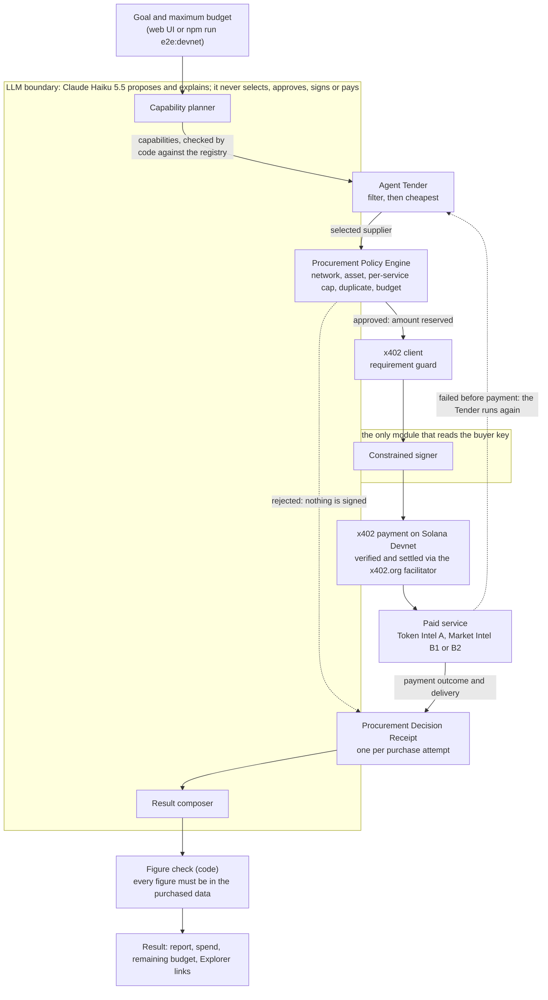

# BDC AgentFlow — Architecture

A small modular monolith in TypeScript on Node.js 22, with Express 5, the official x402 packages (`@x402/core`, `@x402/express`, `@x402/fetch`, `@x402/svm`, 2.28.0) and `@solana/kit` 5.5.1. No database, no framework beyond Express, no build step. Solana Devnet only; the paid services are this project's own and run locally. See [README.md](README.md) for setup and [DEMO.md](DEMO.md) for the demo.

## Diagram

## System components

| Component | File | Role |
|---|---|---|
| Web UI | `public/index.html`, `src/ui/app.ts`, `scripts/ui-server.ts` | One page and a JSON / Server-Sent Events API on `127.0.0.1:4020`; streams the agent's events live |
| Terminal entry | `scripts/e2e-devnet.ts` | The same agent run from the command line, with on-chain checks of every payment |
| Agent orchestrator | `src/agentflow/run-agent.ts` | Goal → plan → procurement → composed result |
| Capability planner | `src/agentflow/planner.ts` | Maps the goal to registry capabilities (LLM, or a labelled keyword plan) |
| Service registry | `src/registry/services.ts` | The approved providers: id, name, capability, endpoint, port, price, payment network and asset, status |
| Agent Tender | `src/agentflow/tender.ts` | Compares the candidates of a capability and selects one, with a reason for each |
| Procurement runner | `src/agentflow/procure.ts` | Buys each capability, handles failure and fallback, emits events, builds receipts |
| Procurement Policy Engine | `src/policy/engine.ts`, `src/policy/rules.ts` | Authorizes or rejects a proposed purchase before anything is signed |
| Session ledger | `src/policy/session.ts` | Budget, reservations, spend and the duplicate-purchase key |
| Purchase | `src/payments/purchase.ts` | Policy decision, then payment; maps the payment outcome to the ledger |
| x402 payment client | `src/payments/client.ts`, `src/payments/requirement-guard.ts` | `@x402/fetch` with the `exact` Solana scheme and the requirement guard |
| Facilitator preflight | `src/payments/facilitator-preflight.ts` | Checks the facilitator supports x402 V2, `exact`, Solana Devnet |
| Constrained signer | `src/signer/buyer-signer.ts` | Loads the buyer key and hands out a signer, nothing else |
| Paid services | `src/services/service-a.ts`, `src/services/service-b.ts`, `src/services/token-intel.ts` | x402-protected resources: Token Intel A ($0.005), Market Intel B1 ($0.004), Market Intel B2 ($0.008) |
| Receipts | `src/agentflow/receipt.ts` | One Procurement Decision Receipt per purchase attempt |
| Events | `src/agentflow/events.ts` | The seventeen structured event names |
| Result composer | `src/agentflow/composer.ts`, `src/agentflow/report-check.ts` | The report (LLM, or a labelled template) and its figure check |
| Claude API client | `src/llm/claude.ts` | One `fetch` call to the Messages API, no SDK |

## AI boundary

Claude Haiku 5.5 (`claude-haiku-5-5`) is used twice per run, each call with a 20-second timeout and one attempt:

- **Planner.** It receives the goal and each registry entry's capability and name (no prices, no addresses) and answers in a fixed JSON schema: interpretation, capabilities, token, unsupported. Code then validates the answer: a capability the registry does not offer moves to `unsupported`; a goal naming a token other than JUP is refused and nothing is planned.
- **Composer.** It receives the goal, the plan's interpretation, the unsupported needs, the delivered data and a summary of the purchases (capability, provider, quoted price, outcome, fallback). It never receives a key, the buyer's or the seller's address, a transaction signature or a fingerprint. Its report must name snapshot and cached-fallback data as such, and its prompt forbids computing new figures.

The LLM does not select the supplier (the Agent Tender does), does not approve a purchase (the policy engine does), never reaches the signer, cannot set or raise the budget ("Maximum budget" in a goal is never parsed), and cannot change the network or the asset. The planner, the composer and the orchestrator read no environment variable and import nothing from the signer or the payment client; the UI app imports only types from the agent modules.

**Figure check.** Before the report is shown, code checks every figure in it against the purchased data, the receipts summary, the goal and the budget line (`src/agentflow/report-check.ts`). A `%` figure must match a field whose name ends in `Pct`, a `$` figure a field whose name contains `Usd` or a dollar amount of the goal or the budget line; a figure may be rounded to fewer decimals. If any figure is unmatched, the report is replaced by the deterministic summary, led by the label "LLM report rejected — figures not in purchased data — deterministic summary". Its limits:

- it verifies that each figure exists in the purchased data with a matching unit, not what the report attributes it to or how it is worded: in a recorded run the report called Market Intel B2's dated snapshot "a cached fallback";
- a bare integer before "hour(s)" or "day(s)" passes only when the same digits occur inside a field name of the purchased data (for example `24` in `priceChange24hPct`);
- figures are compared as IEEE-754 doubles, so the sixth decimal of a ten-digit value is not distinguished;
- a bare integer from 0 to 10 is not checked.

**Without the LLM.** When the API key is missing, a call fails or times out, or the planner's answer is invalid, the run continues on a keyword plan and a template summary, labelled "LLM unavailable — deterministic plan" and "LLM unavailable — deterministic summary". Purchases, policy checks and receipts are the same on either path. The Claude API's token usage is reported apart from the x402 USDC budget.

## Procurement Policy Engine

A pure function, `evaluate(proposal, ledger, rules)`: no I/O, no clock, no randomness; it reads the ledger and never changes it. The first failing check wins:

1. payment network = Solana Devnet, else `WRONG_PAYMENT_NETWORK`;
2. payment asset = Devnet USDC, else `WRONG_PAYMENT_ASSET`;
3. price ≤ $0.01 per service, else `OVER_SERVICE_CAP`;
4. no entry for the same purchase in the ledger, else `DUPLICATE_PURCHASE` (the key is a SHA-256 of the service id, the method and the canonical URL);
5. price ≤ the remaining session budget, else `OVER_BUDGET`.

The rules are $0.05 per session and $0.01 per service, Solana Devnet and Devnet USDC. The web UI may set a lower session budget, from $0.001 to $0.05, validated by the server; the other rules are unchanged. The network rule applies to the payment network only: Token Intel A's Mainnet data source is not a payment.

## Agent Tender

`runTender` is pure (no I/O, environment, clock or randomness, and no import from the signer or the payments modules). For one capability it lists every registry candidate with a reason code and a one-sentence reason:

- excluded, checked in this order: `NOT_ACTIVE`, `FAILED_IN_SESSION`, `OVER_SERVICE_CAP`, `OVER_BUDGET`;
- the eligible ranked by price, cheapest first, then by the run's reliability count (fewer failures, then more successes), then by service id: the first `SELECTED`, the others `RANKED_LOWER`.

The procurement runner buys the `SELECTED` candidate. If it fails before payment, or the payment explicitly fails, the service joins the run's failed set, counts as a reliability failure and is never retried; the Tender runs again (round 2) and its new choice is bought as a fallback, through the same policy engine. With no eligible candidate the capability is reported as not obtained and nothing is bought. A policy rejection ends the capability with no fallback. The Tender never approves: it only selects.

## Payment boundary

`purchase()` is the only path to a payment, in this order:

1. build the proposal and its duplicate-purchase key;
2. **policy engine**: a rejection returns at once; no request is made and the signer is never reached;
3. **reserve** the amount in the ledger;
4. **pay and fetch** through the x402 client;
5. map the outcome to the ledger:
   - no request carrying `PAYMENT-SIGNATURE` was sent → released, `failed-before-payment`;
   - `PAYMENT-RESPONSE` reports success → recorded as spent, `paid`;
   - `PAYMENT-RESPONSE` reports failure with no transaction → released, `payment-failed`;
   - anything else after a signed request (an error, no response, an undecodable header) → kept reserved, `pending-reconciliation`, and the run stops.

`purchase()` reads no environment variable and never holds the signer: the caller supplies the paying `fetch`.

## Constrained signer

`src/signer/buyer-signer.ts` is the only module that reads wallet signing material (`BUYER_SECRET_KEY_B58`). It returns a `@solana/kit` transaction signer and never logs, returns or serialises the key. It is reached only through the x402 client, after the policy engine has approved the purchase and the requirement guard has accepted the server's payment requirement. The wallets are disposable Devnet wallets, created by `npm run wallets:create`, which writes the keys to the git-ignored `.env` and prints only the public addresses.

## x402 flow

For one paid purchase:

1. AgentFlow requests the service URL (`GET http://127.0.0.1:<port>/v1/...?mint=<JUP mint>`).
2. The service's `paymentMiddleware` answers HTTP 402 with a `PAYMENT-REQUIRED` header: scheme `exact`, network Solana Devnet, asset Devnet USDC, the amount and the recipient.
3. In the x402 client's before-creation hook, the requirement guard checks scheme, network, asset, amount (the registry price) and recipient against what AgentFlow decided to buy; any mismatch aborts before signing (`GUARD_SCHEME`, `GUARD_NETWORK`, `GUARD_ASSET`, `GUARD_AMOUNT`, `GUARD_PAYTO`).
4. The `exact` Solana scheme builds the USDC transfer and the constrained signer signs it.
5. The client repeats the request with a `PAYMENT-SIGNATURE` header.
6. The service verifies and settles the payment through the facilitator (`https://x402.org/facilitator`) and answers HTTP 200 with the resource and a `PAYMENT-RESPONSE` header.
7. AgentFlow decodes `PAYMENT-RESPONSE`; only `success: true` records the spend.

Before any paid route is offered, a preflight asks the facilitator for its supported kinds and stops unless one matches x402 V2, scheme `exact`, network Solana Devnet.

## Solana interaction

- **Payment network:** Solana Devnet, `solana:EtWTRABZaYq6iMfeYKouRu166VU2xqa1`; **asset:** Devnet USDC, mint `4zMMC9srt5Ri5X14GAgXhaHii3GnPAEERYPJgZJDncDU`.
- Each paid purchase is one Devnet transaction transferring the exact price in Devnet USDC from the buyer to the seller, signed by the buyer, with the facilitator as fee payer. Its signature is kept in the receipt with a Solana Explorer link (`https://explorer.solana.com/tx/<signature>?cluster=devnet`).
- `npm run e2e:devnet` also checks, for every paid purchase: (a) HTTP 200; (b) a successful `PAYMENT-RESPONSE` on Solana Devnet with the buyer as payer and a transaction; (c) the transaction confirmed on Devnet with no error; (d) the seller's balance up and the buyer's down by exactly the price; (e) every field of the service's response present. The web UI path does not repeat (a)–(e); its signatures were verified on-chain at review.
- **Data network:** Token Intel A reads JUP's supply and ten largest token accounts from Solana Mainnet through the Helius Mainnet RPC, read-only, with a 20-second timeout. It is kept separate from the payment network in code (`src/config/networks.ts`).

## Resource delivery

- After a `paid` outcome the runner reads the response body once. The resource counts as **delivered** only for HTTP 200 with a body that parses as JSON; the receipt then carries the SHA-256 of the body (`outputFingerprint`) and the event `DELIVERY_VERIFIED` is emitted.
- A paid resource that is not delivered is recorded as `undelivered` and counts as a reliability failure; the capability is **not** bought again from another provider, so it is never paid for twice.
- **Token Intel A** returns live Mainnet data labelled `live`, or, when the RPC fails, a dated cache file labelled `cached fallback` with its own `asOf` and the cause (the RPC method and status, or the error class only).
- **Market Intel B1 and B2** return a dated snapshot of JUP market data (Jupiter Price API V3, as of 2026-11-06T22:31:26.223Z), labelled `snapshot`; B2 is marked "alternative provider". When the failure switch (or `--fail-b1`) is on, B1 answers HTTP 503 to every request before its paywall, so nothing can be paid to it.
- Each service accepts only the JUP mint; any other mint gets HTTP 400 before the paywall.

## Procurement receipts

One Procurement Decision Receipt per purchase attempt, built by a pure function, application-level JSON with atomic amounts as decimal strings:

`receiptId` (run id and attempt number), `createdAt`, `capability`, `candidates` (each with price, reason code and reason), `selected` (id, name, reason), `quotedPriceAtomic`, `quotedPriceUsd`, `policy` (approved, or rejected with its code), `budgetBeforeAtomic`, `budgetAfterAtomic`, `paymentOutcome`, `transaction` and `explorerUrl` (when paid), `delivered`, `requestFingerprint` (SHA-256 of the method and URL), `outputFingerprint` (SHA-256 of the delivered body, when delivered), `isFallback`.

The receipt holds no secret, no environment value and no header. Nothing is written on-chain and nothing is saved to disk. With the receipts the runner returns:

- **events**, in order, from the seventeen names `PLAN_CREATED`, `CAPABILITY_REQUIRED`, `SERVICE_CANDIDATES_FOUND`, `SERVICE_SELECTED`, `PROCUREMENT_DECISION_CREATED`, `PAYMENT_REQUIRED`, `POLICY_APPROVED`, `POLICY_REJECTED`, `PAYMENT_AUTHORIZED`, `PAYMENT_SETTLED`, `RESOURCE_RECEIVED`, `DELIVERY_VERIFIED`, `SERVICE_FAILED`, `SERVICE_SKIPPED`, `FALLBACK_SELECTED`, `PROCUREMENT_RECEIPT_CREATED`, `RESULT_COMPOSED`. They are derived from each purchase's outcome, not observed on the wire. Because the policy engine runs before any request, `POLICY_APPROVED` comes before `PAYMENT_REQUIRED`. `SERVICE_SKIPPED` is defined but never emitted (the Tender already excludes a failed provider);
- the Tender table of every round, the capabilities not obtained (`unfulfilled`) or not delivered (`undelivered`), the remaining budget, whether the run stopped early, and the reliability counts, which last for one run only.

## Security boundaries

- **Secrets by class.** The buyer key is read only by `src/signer/buyer-signer.ts`; `HELIUS_API_KEY` only by `src/services/token-intel.ts` (it travels in the RPC URL, so that URL is never logged, printed or thrown); `ANTHROPIC_API_KEY` only by `src/llm/claude.ts`; `JUPITER_API_KEY` only by `scripts/capture-market-snapshot.ts`. All live in the git-ignored `.env`. Errors carry a method and a status, never a key, a URL or a header. Tests use dummy keys and never read `.env`.
- **Decision before signature.** Planner and composer (LLM) → Agent Tender → policy engine → requirement guard → signer. Nothing can reach the signer without the policy engine's approval, and a policy rejection never sends a request.
- **No AI authority over money.** The LLM cannot select, approve, sign, raise the budget, or change the network or the asset; its report is checked by code before it is shown.
- **Web UI.** `127.0.0.1:4020` only; a request whose `Host` is not `127.0.0.1:4020` or `localhost:4020` gets 403; every response carries `Content-Security-Policy: default-src 'self'; script-src 'self' 'unsafe-inline'; style-src 'self' 'unsafe-inline'; img-src 'self'; connect-src 'self'; base-uri 'none'; form-action 'none'; frame-ancestors 'none'`; no CORS header; bodies of at most 4 KB, validated on the server; one run at a time; errors are short codes with no stack trace or path. The page renders every text with `textContent`, never as HTML, and builds Explorer links only from a valid base58 signature. The browser receives no secret, environment value or header.
- **Ports.** 4020 (UI) and 4021–4023 (the three services), all on `127.0.0.1`.
- **Production.** Not built. A production deployment would isolate payment authorization and signing further than this hackathon build does, for example by running the signer as a separate service with its own spending limits, holding keys outside the application's environment, and keeping persistent, reconciled receipts.
